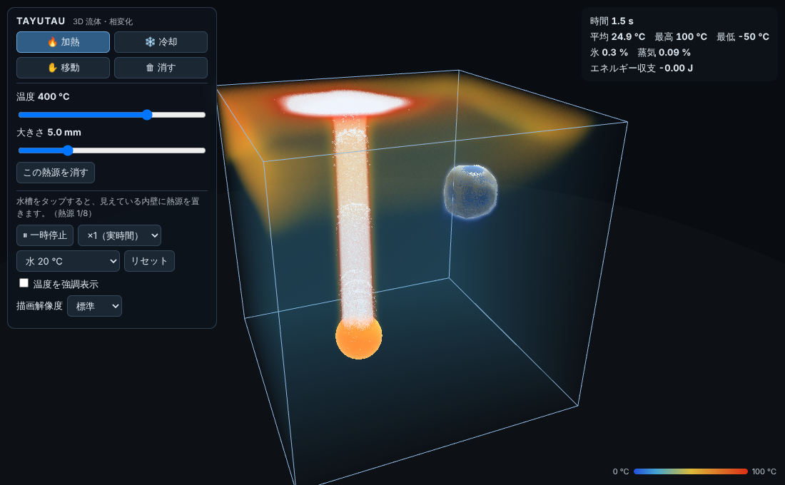

# TAYUTAU
たゆたゆしよう。

ブラウザで動く 3D の水のシミュレータです。水槽の中に熱源・冷却源を置くと、温まった水が対流し、
100 °C を超えると沸騰して泡と蒸気が上がり、0 °C を下回ると凍って固体（氷）になります。
計算はすべて WebGPU のコンピュートシェーダーで行い、結果は CPU に戻さずにそのまま描画します。



## 起動方法

必要なもの: Node.js 20 以降、WebGPU に対応したブラウザ（Chrome / Edge 113 以降のデスクトップ版など）。

```sh
npm install
npm run dev        # http://localhost:5173 を開く
```

本番ビルド:

```sh
npm run build      # dist/ に静的ファイルを出力（型チェック込み）
npm run preview    # ビルド結果をローカルで確認
```

- WebGPU が使えないブラウザでは、その旨のメッセージを表示します（WebGL での代替表示はありません）。
- 格子の細かさは URL で変えられます: `?n=32`（軽い）〜 `?n=64`（重い）。既定は 48³。

## 操作

| 操作 | マウス | タッチ |
|---|---|---|
| 視点を回す | 何もない所をドラッグ | 1 本指ドラッグ |
| ズーム | ホイール | ピンチ |
| 熱源・冷却源を置く | 「🔥 加熱」「❄️ 冷却」を選び、水槽をクリック（見えている内壁、例: 上から見れば底に置かれる） | タップ |
| 動かす | 熱源をドラッグ（カメラに向いた面内で移動） | ドラッグ |
| 消す | 「🗑 消す」で熱源をクリック、熱源をダブルクリック、選択して Delete キー、パネルの「この熱源を消す」 | 「消す」でタップ、ダブルタップ |
| 温度・大きさ | 熱源を選ぶとパネルのスライダーで変更（−60〜600 °C） | 同じ |

パネルでは一時停止、速度（×0.5〜×4）、初期状態（水 20 °C／冷水 2 °C／氷の塊）、温度の強調表示、描画解像度を選べます。
右上の HUD は GPU 上で集計した平均・最高・最低温度、氷と蒸気の割合、エネルギー収支を表示します。

## テスト

```sh
npm test           # CPU と GPU の両方
npm run test:cpu   # 物理層（Node だけで動く）
npm run test:gpu   # WGSL カーネルとアプリ（Chromium + WebGPU）
```

- GPU テストは Playwright の Chromium を使います。初めての環境では `npx playwright install chromium` が必要です。
  Linux で画面がない環境では Xvfb を自動で起動し、SwiftShader（ソフトウェア Vulkan）上の WebGPU で実行します
  （ヘッドレスの Chromium では WebGPU の canvas 表示が落ちるため）。ブラウザを指定するときは `TAYUTAU_CHROMIUM=/path/to/chrome`。
- `reservoir-py/` は ESN（リザバー）の検証です: `python -m pytest -q reservoir-py`（後述）。

テストで確かめていること（主なもの）:

- 質量: 圧力投影後の速度の発散がほぼゼロ（非圧縮）、壁と氷の面を流れが通らない、保存形の移流で輸送量の総和が丸め誤差内で保存。
- エネルギー: 熱源なしの閉じた断熱水槽で全エンタルピーが保存、熱源ありでは「全エネルギーの変化 = 熱源が出し入れした熱」。
  倍精度ではすべての過程（加熱・伝導・対流・沸騰・凝縮・凍結）を同時に回して相対誤差 1e-12 以内、
  実際の f32 格納では 1e-5 以内。GPU 上でも同じ収支を確認。
- 物理: 水の密度（Kell 1975）が表の値と一致し 4 °C で最大、加熱でプルームが上昇（重力ゼロとの比較）、
  熱伝導が誤差関数の解析解に一致、凍結の界面が 1 次元 Stefan 問題の Neumann 解に一致、氷の塊が融けて水温が下がる、
  沸騰中は 100 °C で頭打ちになり蒸気が上部に集まる、過冷水中で蒸気が凝縮して周りを温める。
- GPU の WGSL カーネルが CPU の参照実装と一致（1 ステップでエンタルピー差 5 J/kg 未満。比エンタルピーは約 4×10⁵ J/kg）。
- アプリ: 起動・描画、マウスで熱源を置く／動かす／消す、カメラ操作、沸騰で泡が出る、WebGPU がないときのメッセージ。

## 物理モデル

詳しくは [docs/physics-model.md](docs/physics-model.md)。要点:

- 格子: 1 辺 5 cm の閉じた水槽を 48³ の MAC（スタガード）格子で離散化。壁は滑りなし（法線方向ゼロ）・断熱。
- 流れ: Stam (1999) の作用素分割。速度は RK2 のセミラグランジュ移流、浮力（Boussinesq）、渦度閉じ込め（Fedkiw ら 2001）、
  赤黒 SOR による圧力投影。
- 熱と相変化: エンタルピー法。各セルが比エンタルピー H を持ち、温度・氷の割合・蒸気の割合は H だけから決まる
  （潜熱の台地: 融解 334 kJ/kg、蒸発 2257 kJ/kg）。H は保存形（MUSCL/minmod）で移流するので総量が保存する。
- 凍結: 氷の質量割合が 0.5 を超えたセルを固体として扱い、そのセルの面の速度をゼロにする（その場で固まる）。
- 沸騰: 100 °C に達したセルで蒸気が生じ、蒸気は液に対して上向きに滑って移動する（液と入れ替わる保存形の流束）。
  過冷の水に入ると凝縮して潜熱を渡す。泡の粒子は表示用で、質量もエネルギーも持たない。
- 圧力は 1 気圧で一定と仮定（融点 0 °C・沸点 100 °C 固定）。

### ゲーム用に縮めた・変えた値

| 項目 | 実際 | このシミュレータ | 理由 |
|---|---|---|---|
| 熱伝導率 | 水 0.6、氷 2.2 W/(m·K) | 10 倍 | 実際の値だと 1 cm 凍るのに数分かかるため |
| 熱源と水の熱伝達係数 | 自然対流 10²〜10³、核沸騰 10⁴〜10⁵ W/(m²·K)（桁のみ・未確認） | 1.5×10⁴ | 400 °C の熱源のまわりで数秒以内に沸騰させるため |
| 蒸気の浮力 | ボイド率どおり（ほぼ g） | 0.05 倍 | 粗い格子の Boussinesq 近似では扱えないため |
| 泡の上昇速度（液に対する滑り） | 0.2〜0.3 m/s（桁のみ・未確認） | 0.12 m/s × g/9.81 | 時間刻みの安定条件（CFL）のため |
| 速度の上限 | なし | 各成分 約 8 cm/s（48³ のとき） | 保存形移流の CFL を守るため |
| 水槽の大きさ | — | 5 cm 角（0.125 kg） | 数十秒で沸騰まで進むように |
| 氷の密度 | 917 kg/m³ | 水と同じ扱い | 1 セルの質量を一定にする非圧縮近似のため（氷は浮かず、その場で固まる） |
| 粘性 | 1×10⁻⁶ m²/s | 陽には入れていない | 移流の数値拡散のほうが大きいため |

物性値（比熱、潜熱、熱伝導率、密度）は実際の値です（出典と確度は `src/sim/water.ts` のコメント）。

## リザバー（ESN）の実験トラック

設計メモ（`docs/`）と調査（`research/`）にある、リザバー計算で流体の一部を近似する実験は、物理層とは独立した
補正の実験トラックです。ブラウザのシミュレータの動作には必要ありません。`reservoir-py/` に Lorenz 系での標準 ESN の検証があります。

## 構成

```
src/sim/water.ts        水の熱力学（エンタルピー ⇔ 温度・相、Kell の密度式）
src/sim/params.ts       パラメータ（ゲーム用の値は [GAME] と明記）
src/sim/cpuSolver.ts    物理層の参照実装（仕様）。テストはこれで物理を確かめる
src/gpu/kernels.ts      同じ計算の WGSL カーネル（定数は water.ts から生成）
src/gpu/gpuSolver.ts    バッファとディスパッチ（Babylon.js ComputeShader）
src/render/volume.ts    エンタルピー場を直接レイマーチングする描画（温度色・氷の面・蒸気）
src/render/bubbles.ts   泡の GPU 粒子
src/ui/                 熱源の操作と UI
tests/cpu, tests/gpu    テスト（gpu-harness/ はブラウザ側のテスト用ページ）
```
